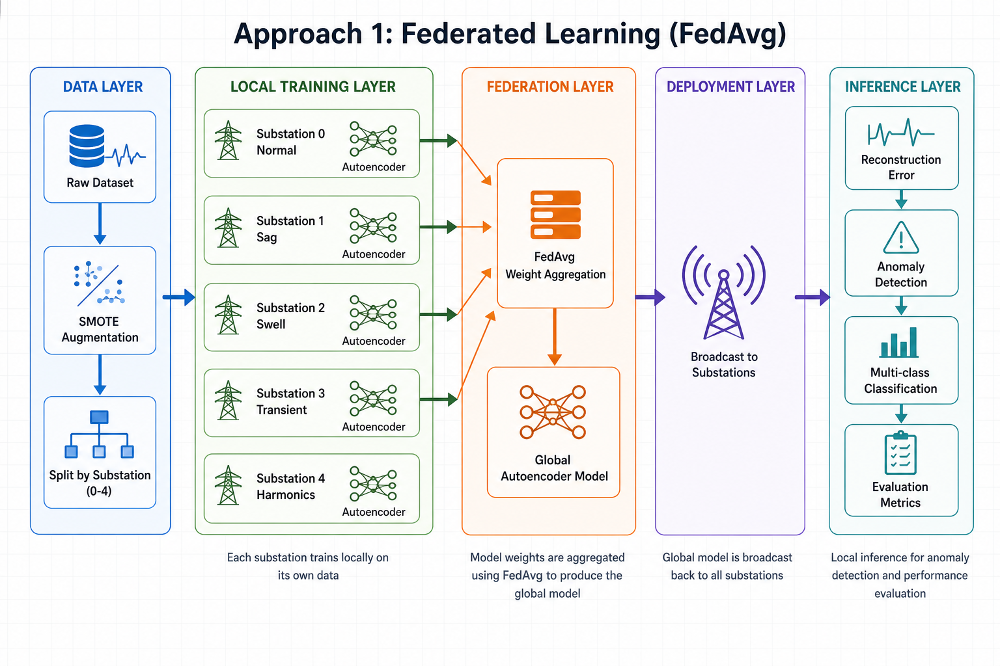
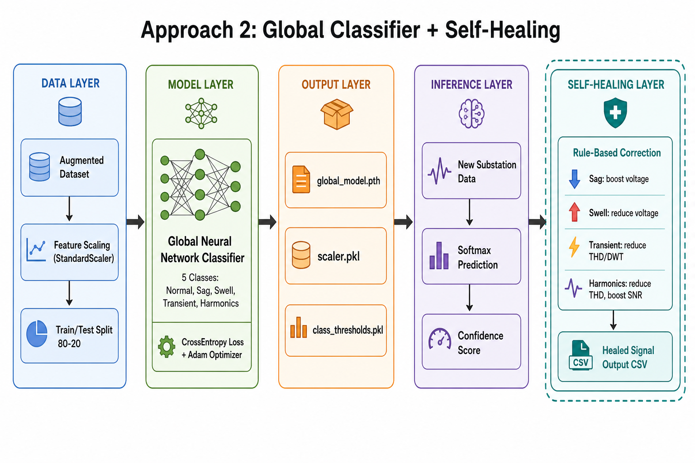

# Federated Power Substation Fault Detection

A machine learning system for detecting and classifying electrical power-quality faults across distributed substations. Signal features — voltage, THD, wavelet energy, and SNR — are used to identify **Sag**, **Swell**, **Transient**, and **Harmonics** faults while keeping normal operation as a baseline class.

The project implements **two independent pipelines**: a privacy-oriented federated autoencoder approach and a centralized classifier with self-healing.

---

## Table of Contents

- [Approach 1 — Federated Learning](#approach-1--federated-learning-fedavg)
- [Approach 2 — Global Classifier & Self-Healing](#approach-2--global-classifier--self-healing)
- [Fault Classes](#fault-classes)
- [Dataset](#dataset)
- [Getting Started](#getting-started)
- [Project Structure](#project-structure)
- [Outputs](#outputs)
- [License](#license)

---

## Approach 1 — Federated Learning (FedAvg)

Local autoencoders are trained at each substation on fault-specific data. Model weights are aggregated centrally using **Federated Averaging (FedAvg)** — raw substation data never leaves the local node. The global model is then broadcast back for anomaly detection and evaluation.

### Architecture

<p align="center">
  
</p>

### Pipeline Stages

| Stage | Scripts | What happens |
|-------|---------|--------------|
| **1. Data prep** | `augmentation.py`, `split_dataset.py` | SMOTE oversampling, noise injection, split into 5 substation CSVs |
| **2. Local training** | `train_substation0.py` … `train_substation4.py` | Per-substation autoencoder training, threshold & scaler saved |
| **3. Federation** | `fedavg_training.py` | FedAvg weight aggregation, global thresholds & scaler |
| **4. Deployment** | `broadcast_global_model.py` | Global model copied to each substation |
| **5. Detection** | `detect_anomalies_all_substations.py` | Reconstruction-error anomaly detection |
| **6. Evaluation** | `fedavg_evaluation.py`, `local_test_fed.py` | Accuracy, precision, recall, F1 across substations |

### Run

```bash
cd "project work 1"

python augmentation.py
python split_dataset.py

python train_substation0.py
python train_substation1.py
python train_substation2.py
python train_substation3.py
python train_substation4.py

python fedavg_training.py
python broadcast_global_model.py
python detect_anomalies_all_substations.py
python fedavg_evaluation.py
```

### Key Idea

```
Local data stays local  →  Only model weights are shared  →  Global autoencoder detects anomalies via reconstruction error
```

---

## Approach 2 — Global Classifier & Self-Healing

A single **5-class neural network** is trained on the full augmented dataset. New substation readings are classified with softmax confidence scores. Detected faults trigger **rule-based self-healing** that adjusts signal features back toward normal operating ranges.

### Architecture

<p align="center">
  
</p>

### Pipeline Stages

| Stage | Scripts | What happens |
|-------|---------|--------------|
| **1. Training** | `gobal_model_final_1c.py` | Train global classifier, save model, scaler, per-class thresholds |
| **2. Inference** | `multiclass_gobal_model_test.py` | Predict fault class on new substation data |
| **3. Self-healing** | `self_heal_predict.py` | Classify + apply corrective rules per fault type |

### Self-Healing Rules

| Fault | Corrective action |
|-------|-------------------|
| **Swell** | Reduce RMS & peak voltage, shorten duration |
| **Sag** | Increase RMS & peak voltage |
| **Transient** | Reduce THD and DWT energy levels |
| **Harmonics** | Reduce THD, increase signal-to-noise ratio |
| **Normal** | No changes applied |

### Run

```bash
cd "project work 1"

python gobal_model_final_1c.py
python multiclass_gobal_model_test.py
python self_heal_predict.py
```

### Key Idea

```
Centralized training on full dataset  →  Direct multi-class prediction  →  Automatic signal correction after fault detection
```

---

## Fault Classes

| Label | Class | Substation | Local training script |
|-------|-------|------------|----------------------|
| 0 | Normal | 0 | `train_substation0.py` |
| 1 | Sag | 1 | `train_substation1.py` |
| 2 | Swell | 2 | `train_substation2.py` |
| 3 | Transient | 3 | `train_substation3.py` |
| 4 | Harmonics | 4 | `train_substation4.py` |

---

## Dataset

Source file: `project work 1/dataset_augmented (1).csv`

| Column | Description |
|--------|-------------|
| `RMS_Voltage` | Root mean square voltage |
| `Peak_Voltage` | Peak voltage |
| `THD` | Total harmonic distortion |
| `Duration_ms` | Event duration (ms) |
| `DWT_Energy_Level1` | Wavelet energy — level 1 |
| `DWT_Energy_Level2` | Wavelet energy — level 2 |
| `DWT_Entropy` | Wavelet entropy |
| `Signal_Noise_Ratio_dB` | Signal-to-noise ratio (dB) |
| `Label` | Class label (0–4) |

Metadata columns: `ID`, `Fault_Type`, `Phase`

---

## Getting Started

### Requirements

- Python 3.8+
- See `requirements.txt` for full dependency list

### Install

```bash
git clone <your-repo-url>
cd pw1
pip install -r requirements.txt
```

### Local testing (both approaches)

```bash
cd "project work 1"

python local_test_0.py   # Substation 0
python local_test_1.py   # Substation 1
python local_test_2.py   # Substation 2
python local_test_3.py   # Substation 3
python local_test_4.py   # Substation 4
python local_test_fed.py # Two-stage federated detection
```

> **Note:** Run all scripts from the `project work 1` directory so relative paths resolve correctly. Later steps depend on outputs from earlier steps (e.g. `.pth` model files).

---

## Project Structure

```
pw1/
├── README.md
├── requirements.txt
├── docs/
│   ├── architecture-approach-1-federated.png
│   └── architecture-approach-2-classifier.png
└── project work 1/
    ├── augmentation.py
    ├── split_dataset.py
    ├── train_substation0.py … train_substation4.py
    ├── fedavg_training.py
    ├── broadcast_global_model.py
    ├── detect_anomalies_all_substations.py
    ├── fedavg_evaluation.py
    ├── gobal_model_final_1c.py
    ├── multiclass_gobal_model_test.py
    ├── self_heal_predict.py
    ├── local_test_0.py … local_test_4.py
    ├── local_test_fed.py
    ├── bct.py                  # Standalone blockchain demo
    ├── dataset_augmented (1).csv
    ├── substation_*.csv
    ├── aug_dataset/
    └── results/
```

---

## Outputs

| File | Pipeline | Description |
|------|----------|-------------|
| `substation_*_best_autoencoder.pth` | Federated | Local autoencoder weights |
| `global_federated_model.pth` | Federated | Aggregated global model |
| `threshold_substation_*.pkl` | Federated | Per-substation anomaly thresholds |
| `evaluation_summary.csv` | Federated | Detection metrics |
| `global_model.pth` | Classifier | Centralized classifier weights |
| `scaler.pkl` | Classifier | Feature scaler |
| `class_thresholds.pkl` | Classifier | Per-class probability thresholds |
| `substation_self_healed.csv` | Classifier | Predictions + healed signal values |

---

## License

MIT — update this section with your chosen license before publishing.
